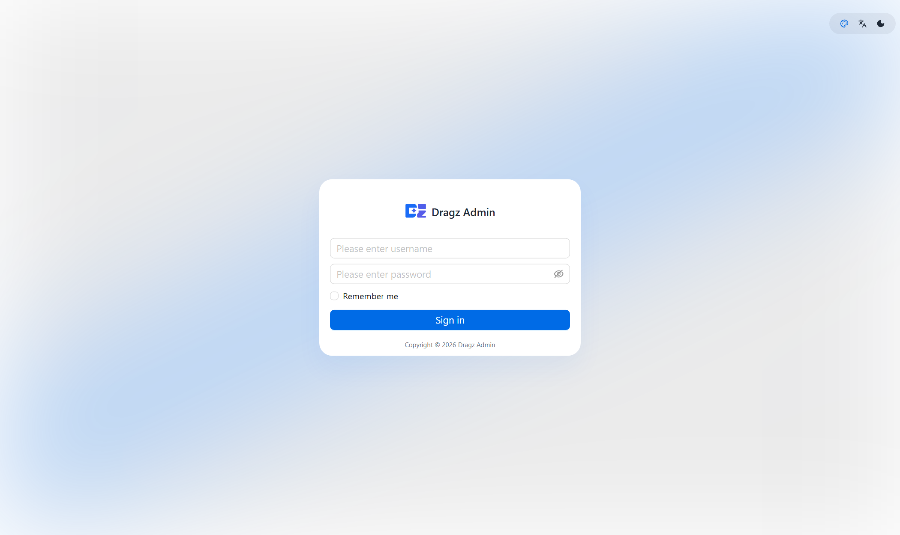
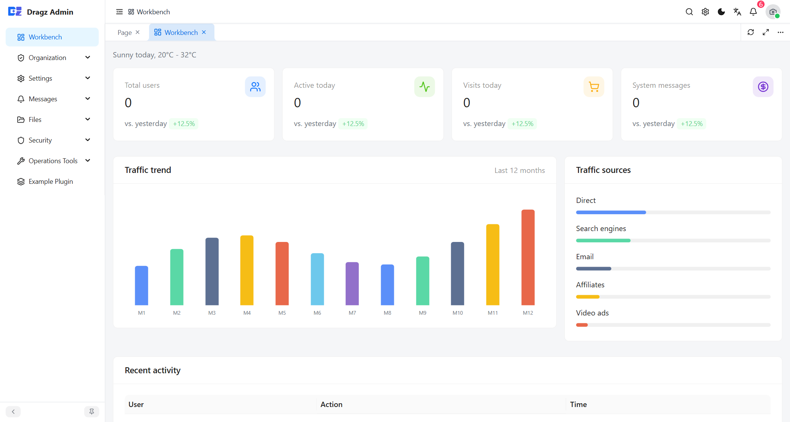
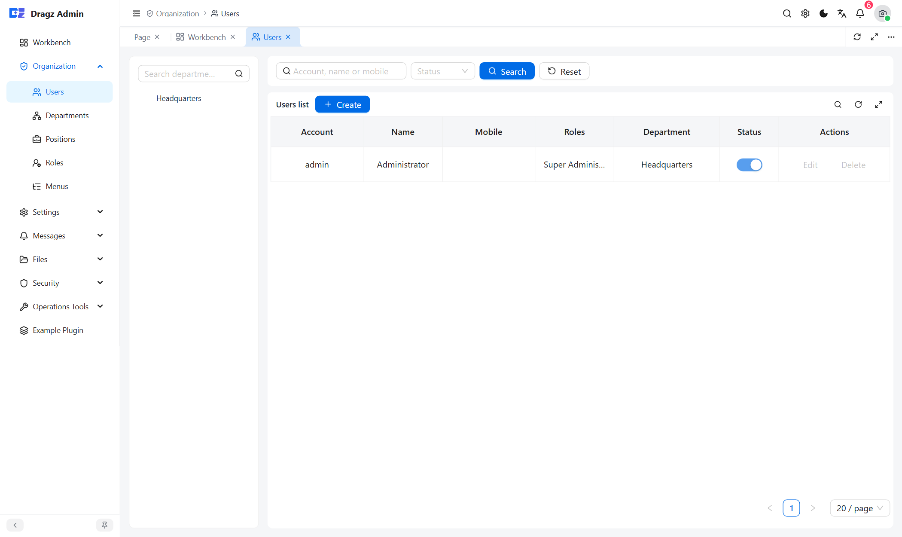
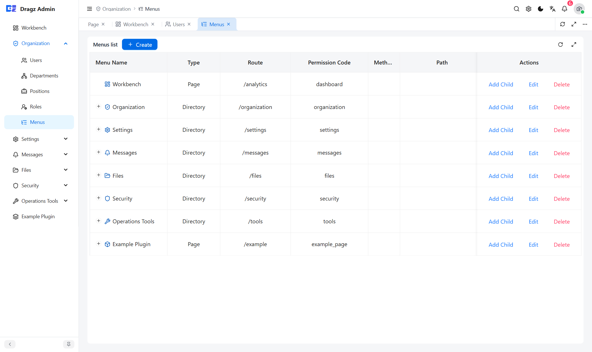
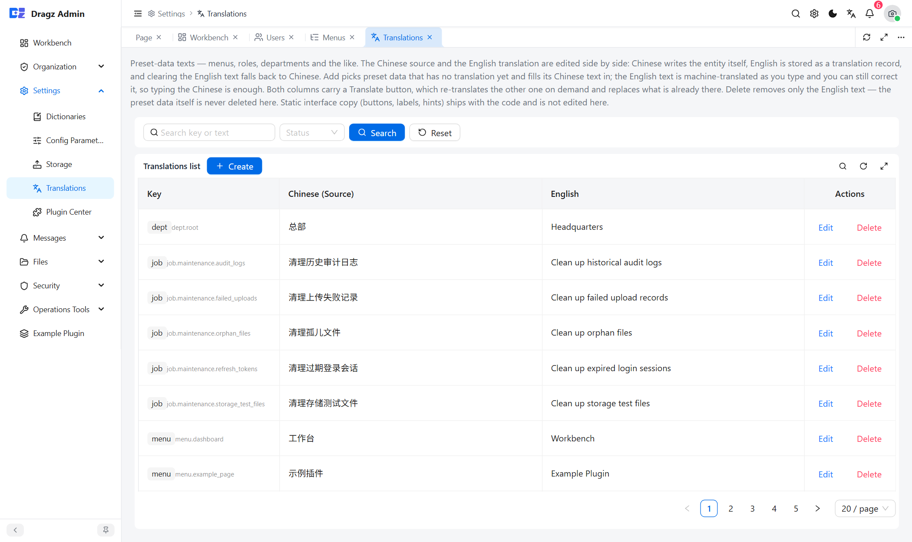
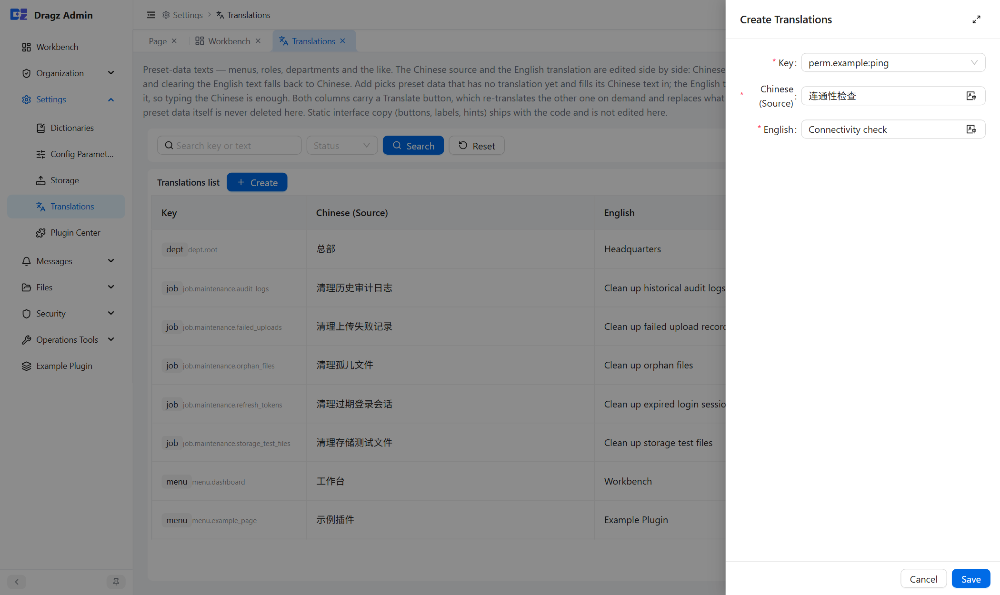

# dragz

[](https://github.com/tianjinli/dragz/actions/workflows/ci.yml)
[](LICENSE)

**English** | [中文](README_CN.md)

A plugin-based admin foundation: **Go + go-zero + PostgreSQL + React**. Business features plug in at compile time, and the codebase is organised around plugin boundaries as a starting point for secondary development.

- Backend: go-zero rest, pgx + sqlc, Casbin (3-tuple), asynq (scheduled jobs), go-i18n
- Frontend: React 19 + TypeScript + Ant Design + Vite + zustand
- Data: PostgreSQL 16 (only engine) + Redis 7.4 (cache / queue)

## Screenshots

| Sign in | Dashboard |
| --- | --- |
|  |  |

| Users & departments | Menu tree |
| --- | --- |
|  |  |

| Translation management | Creating a translation (only the Chinese is typed) |
| --- | --- |
|  |  |

## Layout

```
backend/
  api/                route registration and OpenAPI entry
  cmd/                admin-api (HTTP), jobs-runner (scheduler/worker), gen-api
  internal/
    app/              runtime Context (dependency wiring + auth helpers)
    httpapi/          HTTP layer: routes, handlers, middleware chain
      logic/          orchestration layer (handlers never depend on store directly)
    kernel/           route table assembly, plugin registry, route baseline
    menuperm/         permission code → menu button mapping as pure functions (stdlib only)
    plugin/           plugin contract (Meta / Route / Plugin)
    pluginstate/      boundary package for plugin enabled state (stdlib only)
    store/            data access (SQL lives in queries/, sqlc output in store/sqlc)
    security/         tokens, key encryption, private key parsing
    jobs/             scheduled job contract and runner
    pkg/              error mapping, i18n, ctx keys, casbin wrapper
  platform/           platform capabilities (migrate engine, plugincenter)
  plugins/            business plugins (system is core, example is the reference)
  queries/            sqlc SQL sources
  schema/             table snapshot aligned with migrations
  migrations/         bootstrap scripts that run only on an empty database
  docs/               conventions and component docs
  etc/                config samples
deploy/               one-command deploy scripts, compose, k3s manifests
frontend/admin/       admin frontend
```

## Quick start

Requires Docker Desktop (or any compose runtime) + Git Bash.

```bash
bash deploy/up.sh            # full stack: build the frontend, start postgres/redis/api/web
bash deploy/ps.sh            # status + health probes
bash deploy/logs.sh          # follow logs
bash deploy/down.sh          # stop, keep data volumes
bash deploy/reset.sh         # wipe and recreate the database
```

After startup:

- Admin: <http://127.0.0.1:5279>
- Health: <http://127.0.0.1:5280/api/health>
- Default account `admin` / `Dragz!7xZ` (password change is forced on first login)

If a port is taken, remap it in `deploy/ports.override.yml` instead of editing the compose files in the repo. Details: [deploy/README.md](deploy/README.md).

## Local development (backend outside containers)

```bash
bash deploy/dev-infra.sh                 # start postgres + redis only

cd backend
go run ./cmd/admin-api -f etc/admin-api.yaml
go run ./cmd/jobs-runner -f etc/jobs-runner.yaml   # only when scheduled jobs are needed

cd frontend/admin
pnpm install
pnpm dev                                 # 5279, /api proxied to 127.0.0.1:5280
```

## Quality gate

All of these must be green before committing:

```bash
cd backend
go build ./... && go vet ./... && go test ./...
gofmt -l .                               # must be empty
bash scripts/check-imports.sh            # three-layer dependency direction
bash scripts/check_fail_i18n.sh          # message keys aligned across zh/en
go run ./cmd/gen-api                     # regenerate openapi.json when routes change

cd ../frontend/admin
pnpm typecheck && pnpm lint && pnpm check:i18n && pnpm test && pnpm build
```

Machines with `make` can run `make verify` (the backend group above).

## Architecture rules

1. **Three layers, one direction**: `plugins/ → platform/ → kernel/`. Plugins never import each other; they communicate only through eventbus / platform interfaces, and kernel and platform know no concrete plugin. `scripts/check-imports.sh` enforces this.
2. **A permission code is a menu button**: every permission code is a `sys_menu` row with `type='button'`, stored in the `code` column. There is no separate API permission table and no second grant tree. The route table is the single source of truth; buttons are synced at startup.
3. **A disabled plugin is a 404**: the route gate sits *outside* authentication, so an anonymous caller gets a response byte-identical to "path does not exist". Menus are pruned per plugin in SQL, so a disabled plugin loses its codes and pages together.

## Plugin model (30 seconds)

- Registration is **compile time**: `plugins/all/all.go` is the only switch; there is no hot loading.
- New plugins **ship dark**: compiled in with `enabled = false`, migrations do not run, and nothing takes effect until an administrator enables it in System Settings → Plugin Center.
- Disabling only flips the flag — **no table is dropped** — and re-enabling is instant and lossless.
- Only uninstall deletes data, and only for a plugin that is already **disabled**: one transaction drops the tables declared in `Meta.DropTables`, deletes the plugin's menus and migration bookkeeping, and the plugin is back to "never installed".
- A plugin's menus are declared in `Meta.Menus` and keyed by `code`; the platform assigns the id, so a plugin never writes one. Migrations live in `plugins/<id>/migrations/NNN_*.sql` (append-only, checksum-verified).

Writing a plugin: [backend/docs/PLUGIN.md](backend/docs/PLUGIN.md).

## Documentation index

Every document exists in two languages: the plain filename is English, the `_CN.md` sibling is Chinese, and the line under each title switches between them.

| Doc | Contents |
|------|----------|
| [backend/docs/CONVENTIONS.md](backend/docs/CONVENTIONS.md) | Layering, errors and i18n, sqlc, authorization, permission buttons, plugins, bootstrap DDL and migrations |
| [backend/docs/PLUGIN.md](backend/docs/PLUGIN.md) | Plugin development guide: layout, contract, migrations, menus, permissions, self-check list |
| [backend/docs/COMPONENTS.md](backend/docs/COMPONENTS.md) | Components and dependency inventory |
| [backend/docs/NORMS_GAP.md](backend/docs/NORMS_GAP.md) | Settled norms and the multi-database playbook |
| [frontend/admin/README.md](frontend/admin/README.md) | Frontend guide: menu-driven routing, permission codes, request layer, CRUD scaffolding, testing |
| [deploy/README.md](deploy/README.md) | One-command local deploy, port conflicts, production release |

## Known limitations

- **Multi-replica convergence can lag up to 5 seconds**: every replica keeps its own plugin-state snapshot. `admin-api` runs a 5-second watcher after startup that re-reads `sys_plugin`, so a toggle on replica A reaches replica B within one interval at worst (no restart required). Redis subscription was not used: go-zero's redis client exposes no subscriber, and polling a table of a dozen rows is cheaper than one more connection plus reconnect / dropped-message handling. For faster convergence, lower `plugincenter.DefaultWatchInterval`.
- **Single database engine**: PostgreSQL only. `Database.Driver` accepts `postgres`/`postgresql` and is validated at startup. Another engine needs a new store implementation (the `$1` placeholders in sqlc queries, `pqtype` and advisory locks are PG-specific); the business layer does not change. Extension steps: [NORMS_GAP.md](backend/docs/NORMS_GAP.md).
- **Uninstall does not run down-migrations**: migrations are append-only, there are no `down` files. Uninstall relies on the plugin declaring its tables in `Meta.DropTables`; a missing declaration raises no error and leaves orphan tables behind (the self-check list covers this).

## License

[MIT](LICENSE) © 2026 tianjinli
