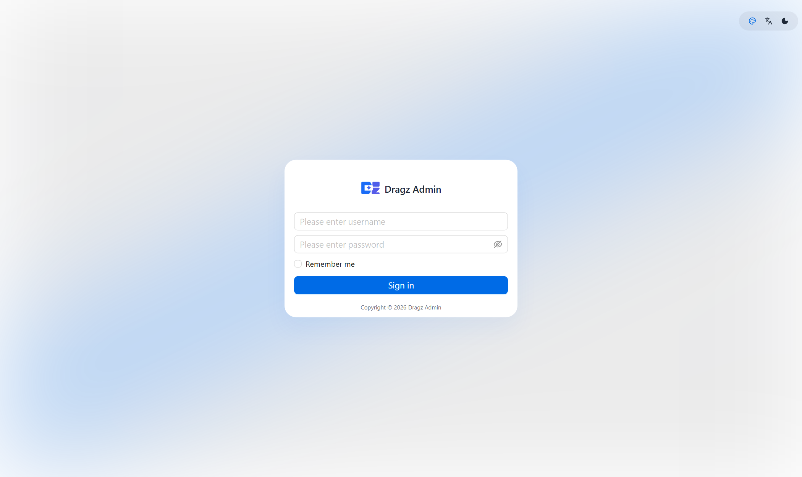
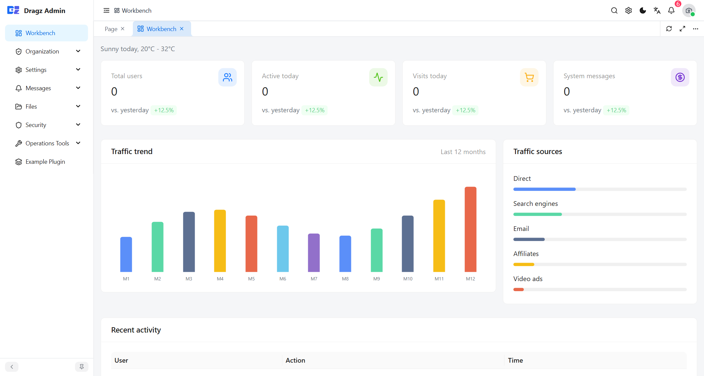
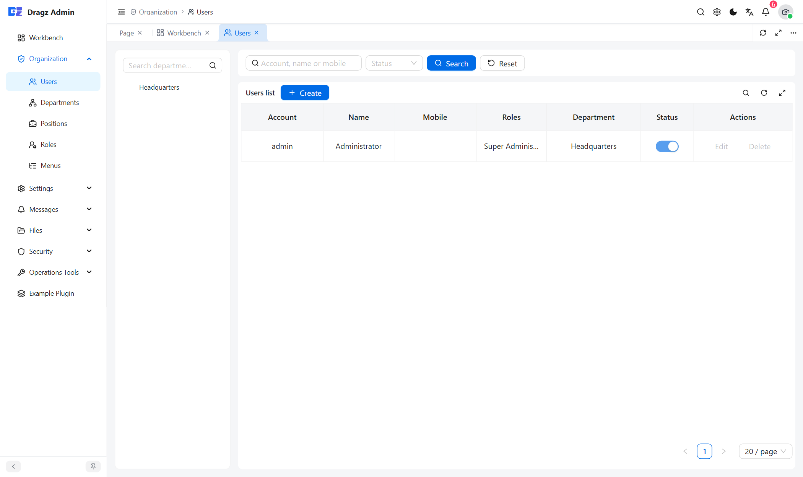
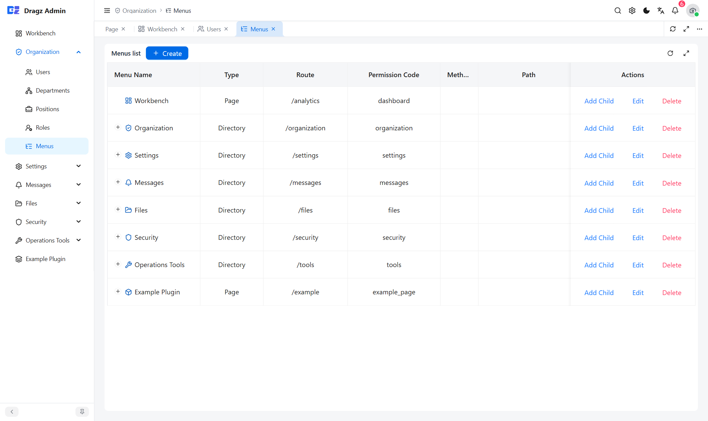
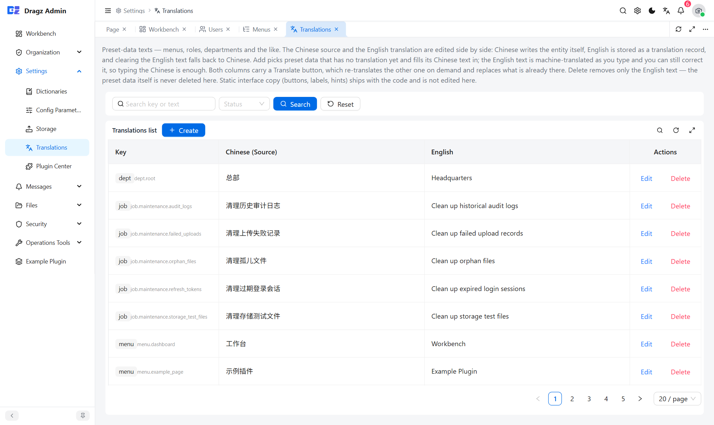
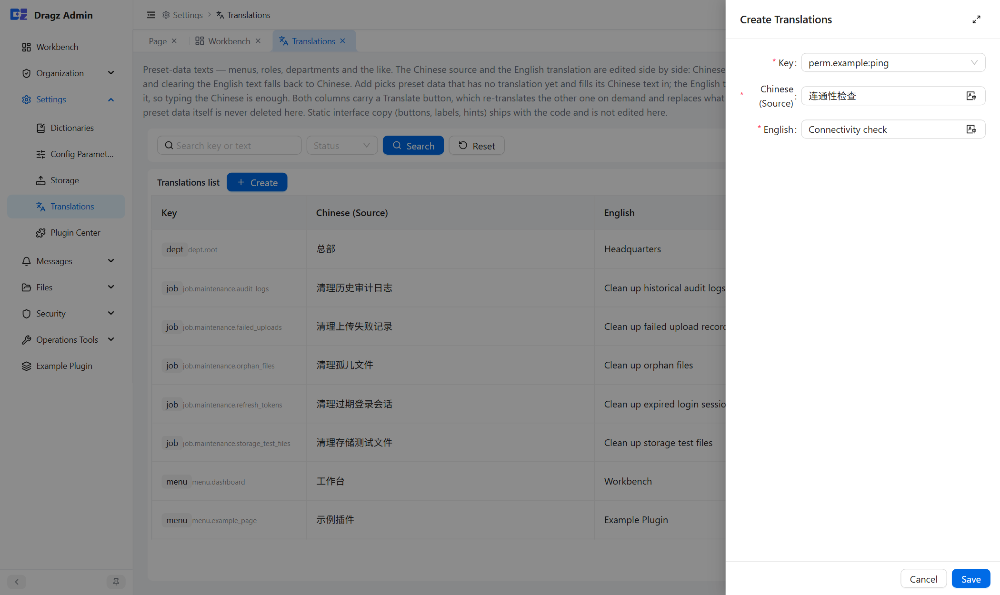

# dragz

[](https://github.com/tianjinli/dragz/actions/workflows/ci.yml)
[](LICENSE)

[English](README.md) | **中文**

一个插件式后台底座：**Go + go-zero + PostgreSQL + React**。业务功能以编译期插件的形式接入，按插件边界组织，作为二次开发的起点。

- 后端：go-zero rest、pgx + sqlc、Casbin（3 元组）、asynq（定时任务）、go-i18n
- 前端：React 19 + TypeScript + Ant Design + Vite + zustand
- 数据：PostgreSQL 16（唯一引擎）+ Redis 7.4（缓存 / 队列）

## 界面预览

| 登录 | 工作台 |
| --- | --- |
|  |  |

| 用户管理（含部门树） | 菜单管理（树表） |
| --- | --- |
|  |  |

| 翻译管理 | 新增翻译（只填中文，英文自动生成） |
| --- | --- |
|  |  |

## 目录结构

```
backend/
  api/                路由注册与 OpenAPI 入口
  cmd/                admin-api（HTTP）、jobs-runner（调度/消费）、gen-api
  internal/
    app/              应用运行时 Context（依赖装配 + 鉴权辅助）
    httpapi/          HTTP 层：路由、处理器、中间件链
      logic/          编排层（处理器不直接依赖 store）
    kernel/           路由表构建、插件注册表、路由基线
    menuperm/         权限码 → 菜单按钮的纯函数映射（仅依赖标准库）
    plugin/           插件契约（Meta / Route / Plugin）
    pluginstate/      插件启用状态的边界包（仅依赖标准库）
    store/            数据访问层（SQL 在 queries/，sqlc 生成到 store/sqlc）
    security/         令牌、密钥加密、私钥解析
    jobs/             定时任务契约与执行器
    pkg/              错误映射、i18n、ctx key、casbin 包装
  platform/           平台能力（migrate 引擎、plugincenter 插件中心）
  plugins/            业务插件（system 为核心，example 为参考实现）
  queries/            sqlc 的 SQL 源
  schema/             与迁移对齐的表结构快照
  migrations/         只在空库执行的建库脚本
  docs/               约定与组件文档
  etc/                配置样例
deploy/               一键部署脚本、compose、k3s 清单
frontend/admin/       管理后台
```

## 快速开始

需要 Docker Desktop（或任意 compose 运行时）+ Git Bash。

```bash
bash deploy/up.sh            # 全栈：构建前端、起 postgres/redis/api/web
bash deploy/ps.sh            # 状态 + 健康探针
bash deploy/logs.sh          # 跟随日志
bash deploy/down.sh          # 停止，保留数据卷
bash deploy/reset.sh         # 清库重建
```

启动后：

- 管理后台 <http://127.0.0.1:5279>
- 健康检查 <http://127.0.0.1:5280/api/health>
- 默认账号 `admin` / `Dragz!7xZ`（首次登录强制改密）

端口被占用时用 `deploy/ports.override.yml` 改映射，不要改仓库里的 compose。细节见 [deploy/README_CN.md](deploy/README_CN.md)。

## 本地开发（不用容器跑后端）

```bash
bash deploy/dev-infra.sh                 # 只起 postgres + redis

cd backend
go run ./cmd/admin-api -f etc/admin-api.yaml
go run ./cmd/jobs-runner -f etc/jobs-runner.yaml   # 需要定时任务时

cd frontend/admin
pnpm install
pnpm dev                                 # 5279，/api 代理到 127.0.0.1:5280
```

## 质量门禁

提交前这些必须全绿：

```bash
cd backend
go build ./... && go vet ./... && go test ./...
gofmt -l .                               # 必须为空
bash scripts/check-imports.sh            # 三层依赖方向
bash scripts/check_fail_i18n.sh          # 文案 key 中英对齐
go run ./cmd/gen-api                     # 路由变了要同步 openapi.json

cd ../frontend/admin
pnpm typecheck && pnpm lint && pnpm check:i18n && pnpm test && pnpm build
```

有 `make` 的机器可以直接 `make verify`（等价于上面后端那组）。

## 架构铁律

1. **三层单向依赖**：`plugins/ → platform/ → kernel/`。插件之间不互相 import，只通过 eventbus / platform 接口通信；kernel 和 platform 不认识任何具体插件。`scripts/check-imports.sh` 强制这一条。
2. **权限码就是菜单按钮**：每个权限码是 `sys_menu` 里 `type='button'` 的一行，码存在 `code` 列。没有独立的接口权限表，也没有第二棵授权树。路由表是唯一真源，启动时自动同步按钮。
3. **插件停用即 404**：路由闸门在认证**外层**，匿名请求拿到的响应与"路径不存在"逐字节相同。菜单在 SQL 层按插件裁剪，停用插件的码和页面一起消失。

## 插件模型（30 秒版）

- 注册是**编译期**的：`plugins/all/all.go` 是唯一的开关，没有热加载。
- 新插件**出厂即暗**：编译进来默认 `enabled = false`，迁移不跑，管理员在「系统设置 → 插件中心」打开才生效。
- 停用只翻开关，**不 DROP 任何表**，重新启用即时无损。
- 卸载才删数据：只对**已停用**的插件开放，一个事务里 DROP 掉 `Meta.DropTables` 声明的表、删菜单和迁移记录，插件回到"从未安装"。
- 插件自己的菜单写在 `Meta.Menus` 里、以 `code` 为键，id 由平台分配，插件不写；迁移放 `plugins/<id>/migrations/NNN_*.sql`（只增不改，checksum 校验）。

写一个插件见 [backend/docs/PLUGIN_CN.md](backend/docs/PLUGIN_CN.md)。

## 文档索引

每篇文档都有两种语言：英文用原文件名，中文用 `_CN.md` 后缀，标题下方的一行用于互切。

| 文档 | 内容 |
|------|------|
| [backend/docs/CONVENTIONS_CN.md](backend/docs/CONVENTIONS_CN.md) | 分层、错误与 i18n、sqlc、授权、权限按钮、插件、启动 DDL 与迁移 |
| [backend/docs/PLUGIN_CN.md](backend/docs/PLUGIN_CN.md) | 插件开发指南：目录、契约、迁移、菜单、权限、自检清单 |
| [backend/docs/COMPONENTS_CN.md](backend/docs/COMPONENTS_CN.md) | 组件与依赖清单 |
| [backend/docs/NORMS_GAP_CN.md](backend/docs/NORMS_GAP_CN.md) | 已拍板的规范与多库扩展 playbook |
| [frontend/admin/README_CN.md](frontend/admin/README_CN.md) | 前端开发指南：菜单驱动路由、权限码、请求层、CRUD 脚手架、测试 |
| [deploy/README_CN.md](deploy/README_CN.md) | 本地一键部署、端口冲突、生产发布 |

## 已知限制

- **多副本有最长 5 秒的生效窗口**：每个副本各持一份插件状态快照。`admin-api` 启动后跑一个 5 秒的
  watcher 定时重读 `sys_plugin`，所以 A 副本上的开关最迟一个周期后在 B 副本生效（不再是"必须重启"）。
  没做 Redis 订阅：go-zero 的 redis 客户端不提供 subscriber，而一张十几行表的轮询比多一条连接加
  重连/丢消息处理更划算。要更快的生效，把 `plugincenter.DefaultWatchInterval` 调小即可。
- **单数据库引擎**：只有 PostgreSQL。`Database.Driver` 只接受 `postgres`/`postgresql`，启动时校验。
  换库需要新增一套 store 实现（sqlc 查询里的 `$1` 占位符、`pqtype`、advisory lock 都是 PG 专有），
  业务层不动。扩展步骤见 [NORMS_GAP_CN.md](backend/docs/NORMS_GAP_CN.md)。
- **卸载不做 down-migration**：迁移是只增不改的，没有 `down` 文件。卸载靠插件在 `Meta.DropTables`
  里显式声明自己建了哪些表；漏声明不会报错，只会留下孤儿表（自检清单里有这一项）。

## 许可证

[MIT](LICENSE) © 2026 tianjinli
