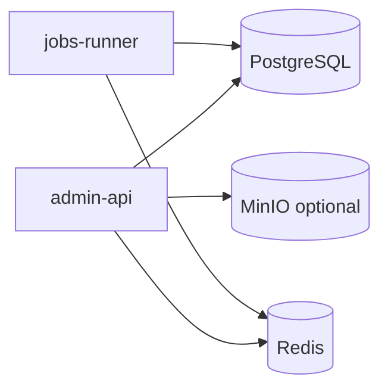

# Backend Component Inventory

**English** | [中文](COMPONENTS_CN.md)

Sources: `backend/go.mod`, `deploy/docker-compose.yml`, `backend/docs/CONVENTIONS.md`.

## Runtime Processes

| Process | Entry point | Role |
|------|------|------|
| admin-api | `backend/cmd/admin-api/main.go` | HTTP API (go-zero rest) |
| jobs-runner | `backend/cmd/jobs-runner/main.go` | Asynq consumer + Cron scheduling |

## Infrastructure (Docker)

- **PostgreSQL 16** — primary database (`postgres:16-alpine`)
- **Redis 7.4** — cache, permission cache, Asynq queue (`redis:7.4-alpine`)
- Local upload volume `upload-data` (object storage not mandatory; MinIO client is wired in and can be switched on via configuration)
- **Migrations**: on first database creation, `deploy/docker-compose.yml` mounts `001_system_init.sql` (system foundation) into `/docker-entrypoint-initdb.d/`; it runs only when the data volume is empty. `001_system_init` defines `sys_user.token_version`; existing databases predating that column require a one-time `ALTER TABLE sys_user ADD COLUMN IF NOT EXISTS token_version BIGINT NOT NULL DEFAULT 0;` (or a rebuilt data volume). `migrations/` keeps only the scripts that participate in database creation (001 / 009); scripts for retired business lines have been removed from the repository, and leftover data in existing databases is idempotently cleaned at startup by `retiredModuleStatements` in `store.PluginRepository.Seed`.

## Direct Dependencies (`go.mod` require)

| Component | Package | Purpose |
|------|-----|------|
| go-zero | `github.com/zeromicro/go-zero` | HTTP framework, logx, config loading |
| pgx | `github.com/jackc/pgx/v5` | PostgreSQL driver |
| Casbin | `github.com/casbin/casbin/v3` | RBAC authorization |
| Asynq | `github.com/hibiken/asynq` | Async task / scheduled job queue |
| cron | `github.com/robfig/cron/v3` | Scheduling expressions (used with jobs-runner) |
| JWT | `github.com/golang-jwt/jwt/v5` | Access Token |
| MinIO SDK | `github.com/minio/minio-go/v7` | File object storage |
| go-i18n | `github.com/nicksnyder/go-i18n/v2` | Multilingual errors / message text |
| uuid | `github.com/google/uuid` | ID generation |
| x/crypto | `golang.org/x/crypto` | Password hashing, etc. |
| x/text | `golang.org/x/text` | i18n language tags |
| go-sqlmock | `github.com/DATA-DOG/go-sqlmock` | Unit test DB mock |

## Indirect but Actively Used Stack

Pulled in through go-zero / Asynq, runtime-relevant:

- **go-redis** — Redis client
- **Prometheus / OpenTelemetry / Zipkin / Pyroscope** — go-zero observability chain (enabled by configuration)
- **gRPC / protobuf** — go-zero ecosystem dependencies (no RPC service is exposed in the current processes)

## Toolchain (Non-runtime)

- **sqlc** — SQL → Go (`backend/sqlc.yaml`, currently a single engine: `postgresql`; generated code is used only by `internal/store`)
- Multi-database extension conventions: see [NORMS_GAP.md](NORMS_GAP.md)

## Specification Documents

- [CONVENTIONS.md](CONVENTIONS.md) — layering, i18n, sqlc, authorization
- [NORMS_GAP.md](NORMS_GAP.md) — gaps and multi-database playbook

## Internal Modules (by responsibility)

- `internal/httpapi` + `logic` — HTTP handling and business orchestration
- `internal/store` (+ `sqlc`) — data access
- `internal/app` — application context, Casbin authorization
- `internal/jobs` + `jobs/runner` — task enqueueing, execution, scheduling
- `internal/filestore` — local/MinIO file storage abstraction
- `internal/security` — JWT, SecretBox config encryption
- `internal/webhook` — webhook delivery
- `internal/pkg` — errors, i18n, casbinx, ctxkey
- `internal/config` — configuration structs

## Business Capability Surface (HTTP side)

As seen in `internal/httpapi`: auth / captcha, users and RBAC, organizations, dictionary, notifications, audit, settings, OAuth, files, tasks, Webhook, Dashboard, feature flags, login lockout, cache.
