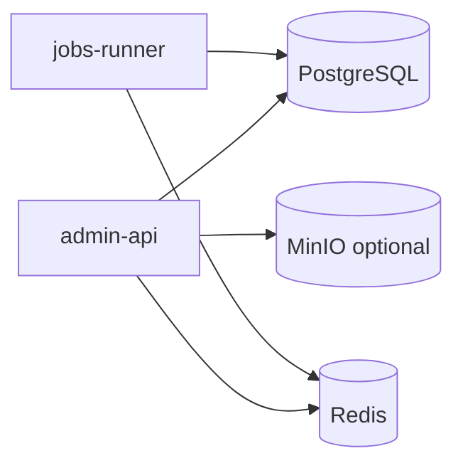

# 后端组件清单

[English](COMPONENTS.md) | **中文**

数据来源：`backend/go.mod`、`deploy/docker-compose.yml`、`backend/docs/CONVENTIONS.md`。

## 运行进程

| 进程 | 入口 | 作用 |
|------|------|------|
| admin-api | `backend/cmd/admin-api/main.go` | HTTP API（go-zero rest） |
| jobs-runner | `backend/cmd/jobs-runner/main.go` | Asynq 消费者 + Cron 调度 |

## 基础设施（Docker）

- **PostgreSQL 16** — 主库（`postgres:16-alpine`）
- **Redis 7.4** — 缓存、权限缓存、Asynq 队列（`redis:7.4-alpine`）
- 本地上传卷 `upload-data`（对象存储未强制；MinIO 客户端已接入，可按配置切换）
- **Migrations**：`deploy/docker-compose.yml` 首次建库时挂载 `001_system_init.sql`（系统底座）到 `/docker-entrypoint-initdb.d/`，仅在数据卷为空时执行。`001_system_init` 定义 `sys_user.token_version`；早于该字段的存量库需一次性执行 `ALTER TABLE sys_user ADD COLUMN IF NOT EXISTS token_version BIGINT NOT NULL DEFAULT 0;`（或重建数据卷）。`migrations/` 下只保留参与建库的脚本（001 / 009）；已下线业务的脚本已移出仓库，存量库里残留的数据由 `store.PluginRepository.Seed` 的 `retiredModuleStatements` 在启动时幂等清理。

## 直接依赖（`go.mod` require）

| 组件 | 包 | 用途 |
|------|-----|------|
| go-zero | `github.com/zeromicro/go-zero` | HTTP 框架、logx、配置加载 |
| pgx | `github.com/jackc/pgx/v5` | PostgreSQL 驱动 |
| Casbin | `github.com/casbin/casbin/v3` | RBAC 鉴权 |
| Asynq | `github.com/hibiken/asynq` | 异步任务 / 定时任务队列 |
| cron | `github.com/robfig/cron/v3` | 调度表达式（配合 jobs-runner） |
| JWT | `github.com/golang-jwt/jwt/v5` | Access Token |
| MinIO SDK | `github.com/minio/minio-go/v7` | 文件对象存储 |
| go-i18n | `github.com/nicksnyder/go-i18n/v2` | 多语言错误/文案 |
| uuid | `github.com/google/uuid` | ID 生成 |
| x/crypto | `golang.org/x/crypto` | 密码哈希等 |
| x/text | `golang.org/x/text` | i18n 语言标签 |
| go-sqlmock | `github.com/DATA-DOG/go-sqlmock` | 单测 DB mock |

## 间接但实际用到的栈

经 go-zero / Asynq 带入，运行时相关：

- **go-redis** — Redis 客户端
- **Prometheus / OpenTelemetry / Zipkin / Pyroscope** — go-zero 可观测性链路（按配置启用）
- **gRPC / protobuf** — go-zero 生态依赖（当前进程内不暴露 RPC 服务）

## 工具链（非运行时）

- **sqlc** — SQL → Go（`backend/sqlc.yaml`，当前单 engine：`postgresql`；生成代码仅供 `internal/store` 使用）
- 多库扩展约定见 [NORMS_GAP_CN.md](NORMS_GAP_CN.md)

## 规范文档

- [CONVENTIONS_CN.md](CONVENTIONS_CN.md) — 分层、i18n、sqlc、鉴权
- [NORMS_GAP_CN.md](NORMS_GAP_CN.md) — 差距与多库 playbook

## 内部模块（按职责）

- `internal/httpapi` + `logic` — HTTP 处理与业务编排
- `internal/store` (+ `sqlc`) — 数据访问
- `internal/app` — 应用上下文、Casbin 授权
- `internal/jobs` + `jobs/runner` — 任务入队、执行、调度
- `internal/filestore` — 本地/MinIO 文件存储抽象
- `internal/security` — JWT、SecretBox 配置加密
- `internal/webhook` — 网络钩子投递
- `internal/pkg` — errors、i18n、casbinx、ctxkey
- `internal/config` — 配置结构

## 业务能力面（HTTP 侧）

从 `internal/httpapi` 可见：认证/验证码、用户与 RBAC、组织、字典、通知、审计、设置、OAuth、文件、任务、Webhook、Dashboard、Feature flag、登录锁定、缓存。
